# 低空航线安全规划与动态避险智能体：功能树与实现逻辑

> **2026-11-12 同步说明：** 本分支已合并上游 `Gindama713/lowalt-dispatch` 的 `main`（`eb099e7`）。下文写于 fork 尚未同步时（基准 `64e4748`，对照的上游提交是 `e3f3346`）。文中「在上游、fork 未同步」的 M3、独立校验器、`apps/web` 静态页、SITL 与控制台，在本分支上已经带着上游代码进来。那些旧标注没有逐段改写。现状以仓库根 [`事实文档.md`](../事实文档.md) 和 [`启动指南.md`](../启动指南.md) 为准。`apps/web/` 静态页保持上游版本；三维前端仍在 `apps/web-3d/`。

> 供前端设计操作入口使用。简体中文。  
> **代码基准：用户 fork `CR878/lowalt-dispatch` 的 `main`（提交 `64e4748`，2026-11-09 22:22，亚洲/上海）。**  
> 上游 `Gindama713/lowalt-dispatch` 的 `main` 为 `e3f3346`（2026-11-09 22:13，亚洲/上海）。两侧在共同祖先 `64d0c54` 之后已经分叉，下文凡与上游不同处单独标注。  
> 只依据仓库代码与仓库文档；上游差异只读 `Gindama713/lowalt-dispatch` 的 `e3f3346`，**不把上游代码抄进本 fork**。参考资料只补充“仅规划”项。  
> 字段约定不在本文重复，见同目录 [`接口契约.md`](接口契约.md)。HTTP 路径与信封见同目录 [`关键接口文档.md`](关键接口文档.md)。  
> 上游文件链接的提交为 [`e3f3346`](https://github.com/Gindama713/lowalt-dispatch/tree/e3f3346409ae2ae76f72d34656411110379d4269)。fork 没有的上游能力一律标明 **在上游、fork 未同步**。

| 项 | 内容 |
|---|---|
| 项目正式方向 | 低空航线安全规划与动态避险智能体（应急配送 + 规划阶段备降可达性硬约束 + 通信退化时云边协作） |
| 验证边界 | 软件在环仿真（SITL）目标；**尚未进行实际飞行测试** |
| 整理日期 | 2026-11-10（亚洲/上海） |
| 主要代码证据 | fork `main` @ `64e4748`（已合并 PR #1 M2 备降硬约束、PR #2 M5 本地 FastAPI） |
| 仓库文档 | `事实文档.md`、`docs/接口契约.md`、`services/api/README.md`、`README.md` |
| 参考资料（仅规划补充） | 《大模块与任务认领表》《推荐技术栈与架构决策》《11月30日交付计划》《课题细化与团队实施方案》 |

## 状态定义与阅读约定

| 状态 | 含义 |
|---|---|
| **已实现** | fork `main` 中有可运行代码，并有测试或事实文档可核对 |
| **未实现** | fork `main` 没有对应实现 |
| **仅规划** | 只出现在认领表、技术方案、目录 README 或 [`接口契约.md`](接口契约.md) 的目标动作里；fork 无实现 |
| **已知问题** | 代码在，但默认结果不可用、请求不生效，或按现有适配会失败。已对照源码 |

一条可以同时标两个状态，例如「已实现（数据模型）；未实现（下发）」。不再使用“部分实现”。

- 模块编号以认领表的 **M1–M6** 为准（2026-11-08 已由旧 8 模块合并）。`core/` 是公共底座，不属于任一模块，本文列为第 0 章。
- **M3 由其他组员负责。** fork `main` 只有预留 hook，无 `agent/`。上游状态机标明 **在上游、fork 未同步**，不算本 fork 已交付。
- 调度任务台仍未开工：`apps/web/` 在 fork 与上游都只有 README，无工程。文中「前端操作入口建议」是设计提示，不是已经存在的任务台页面。
- 三维 / 视觉前端在 `apps/web-3d/`（Vite + React + TypeScript；展厅栈为 R3F / Three.js，态势视图计划用 CesiumJS）。**阶段 0：** 工程骨架、冻结 demo 存档、ENU↔WGS84（`src/geo/enu.ts`，vitest）、锚点决议。**阶段 1：** M350 RTK 比例骨架 69 个部件、四段高光镜头预演脚本；尚无真实材质。天地图 token、Cesium ion token、与后端接线均为 **未实现**。首页仍是阶段 0 占位；60 fps 展厅属于阶段 3，未实现。详见 5.18。
- 对象字段以 [`接口契约.md`](接口契约.md) 与 `core/models.py` 为准。两者在本 fork 的 §2 一致。契约 §3 上表仍是目标：它写「规划出参 `RoutePlan[]`」，代码实际是单条 `PlanResponse`，且默认 `route` 为 null。以代码为准，详见《关键接口文档》。
- `RoutePlan.algorithm` 的字段说明举例写成 `astar_diversion_aware`（`core/models.py`），规划器运行时写入的是 `astar_diversion`。契约正文没有这个举例。展示与请求都以运行时字符串为准。

---

## 功能树总图

```mermaid
flowchart TB
  ROOT["低空航线安全规划与动态避险智能体"]

  ROOT --> M0["0 公共数据契约 core/"]
  ROOT --> M1["1 M1 场景与数据"]
  ROOT --> M2["2 M2 航线规划与安全校验"]
  ROOT --> M3["3 M3 任务 Agent 与云边决策"]
  ROOT --> M4["4 M4 PX4 仿真与执行"]
  ROOT --> M5["5 M5 调度应用与华为云"]
  ROOT --> M6["6 M6 评测与参赛交付"]

  M0 --> M0A["0.1 单位/坐标/高度基准"]
  M0 --> M0B["0.2 溯源与仿真标识"]
  M0 --> M0C["0.3–0.7 五类对象与备降剖面"]

  M1 --> M1A["1.1 草稿场景几何包"]
  M1 --> M1B["1.2 评测任务集 v0"]
  M1 --> M1C["1.3 机型与能量参数"]
  M1 --> M1D["1.4 风/链路标签与通信区 仅规划或标签"]

  M2 --> M2A["2.1 几何原语"]
  M2 --> M2B["2.2 栅格化"]
  M2 --> M2C["2.3 A* 几何基线"]
  M2 --> M2D["2.4 能量模型"]
  M2 --> M2E["2.5 备降硬约束搜索"]
  M2 --> M2F["2.6 独立校验器 上游有 / fork 无"]
  M2 --> M2G["2.7 动态改线 仍为 mock"]

  M3 --> M3A["3.1 HTTP 预留 hook 已有"]
  M3 --> M3B["3.2–3.8 状态机/备用/对账 仅规划或仅上游"]

  M4 --> M4A["4.1–4.6 SITL/MAVSDK/下发 仅规划"]

  M5 --> M5A["5.1–5.10 本地 FastAPI"]
  M5 --> M5B["5.11 Web 任务台 仅规划"]
  M5 --> M5D["5.18 三维视觉前端 阶段0–1；token与后端未实现"]
  M5 --> M5C["5.12–5.17 校验/下发/回放/云部署 仅规划"]

  M6 --> M6A["6.1–6.4 评测 harness 与测试"]
  M6 --> M6B["6.5–6.6 参赛材料与 SITL 证据 仅规划"]
```

---

## 0. 公共数据契约（底座，不属于 M1–M6）

改这里等于改所有模块的接口。权威定义在 `core/models.py`；文字约定在 [`接口契约.md`](接口契约.md)，本文不重复字段表。`SCHEMA_VERSION = "0.1.0"`。

### 0.1 单位、坐标系与高度基准

- **功能说明：** 统一距离（m）、时间（带时区的 UTC `datetime`，场景事件也可用相对任务开始的秒数）、能量（Wh，不是 SOC 百分比）、速度（m/s）。位置用 `Position`：`frame` 为 `enu_m` 或 `wgs84`，二者互斥；高度必须显式给出 `alt_ref`（`amsl` / `agl` / `rel_takeoff`）。
- **实现逻辑：** `Position._check_frame_consistency` 在构造时强制检查：`enu_m` 必须有 `x_m`/`y_m` 且不得带经纬度，反之亦然。校验失败会抛异常，而不是静默混用。
- **状态：** 已实现。证据：`core/models.py` L5–L9、L31–L44、L77–L103；`tests/test_contract.py`。
- **前端操作入口建议：** 任务创建表单按坐标系切换字段：选“局部 ENU”只显示东向/北向米坐标；选“WGS84”只显示经纬度。高度旁必须有基准下拉，禁止只填一个数字。当前 HTTP 规划入口**只接受 ENU**（见 5.5），经纬度任务会被 422 拒绝。`apps/web-3d/src/geo/enu.ts` 已有 ENU↔WGS84 换算和测试，但调度任务台未开工，该换算**未接入** HTTP。任务表单在接通前仍应拦截经纬度提交。
- **待确认（仓库文档仍打开）：** 本地 ENU 原点对应哪块地，或明确声明纯虚拟场景；`velocity` 用 NED 还是 ENU；链路质量取什么量。见 `docs/接口契约.md` 第 5 节。

### 0.2 数据溯源与仿真标识

- **功能说明：** 外部或仿真数据对象必须带 `DataProvenance`，其中 `is_simulated` 决定材料、日志、页面能否称作实测。缺失值用 `None`，禁止用 `0` 或 `-1` 顶替。
- **实现逻辑：** `DataProvenance` 必填 `source`、`version`、`captured_at`、`is_simulated`。HTTP 组装路线时即使任务单把 `is_simulated` 写成 false，路线记录仍强制 `is_simulated=true`（场景几何是草稿仿真）。
- **状态：** 已实现。证据：`core/models.py` L60–L74；`services/api/assemble.py` L13–L16、L115–L116。
- **前端操作入口建议：** 所有地图要素、任务、路线卡片用角标或图例区分“仿真/草稿”与“实测”。不要提供把仿真路线改标为实测的开关。

### 0.3 任务单 Task

- **功能说明：** 一张配送任务。字段不全时必须走确认流程，不允许猜坐标或能量。
- **实现逻辑：** 必填：`task_id`、`origin`、`destination`、`payload_kg`（≥0）、`vehicle_type`、`initial_energy_wh`（>0）、`reserve_energy_wh`（≥0）、`provenance`。可选：`time_limit_s`。Pydantic `extra="forbid"`，多字段直接拒收。
- **状态：** 已实现。证据：`core/models.py` L124–L137。
- **前端操作入口建议：** “新建任务”表单，字段与上表一一对应。提交 `POST /tasks`。地点或电池不明时不要自动填默认坐标/能量。

### 0.4 风险快照、事件与备降点

- **功能说明：** `RiskSnapshot` 是规划器与校验器必须共用的同一份输入；含备降点列表与风险事件。事件类型：`restriction_zone` / `wind` / `link_degradation` / `landing_site_change` / `battery_anomaly`。过期快照不得用于批准新路线（`is_stale`）。
- **实现逻辑：** `RiskEvent.effective_from` 是生效时刻，早于此时进入区域不算违规。高度带 `alt_min_m`/`alt_max_m` 若都给则必须 min ≤ max。`LandingSite` 带半径、适用机型、时窗、`occupied`。空的 `compatible_vehicle_types` 等价于对任何机型都不可用。
- **状态：** 已实现（数据模型）；未实现（风、链路、备降点关闭等事件进入搜索，见 2.5、2.7）。证据：`core/models.py` L109–L181。字段见 [`接口契约.md`](接口契约.md) §2.2、§2.3。
- **前端操作入口建议：** “加载场景生成快照”或“提交自定义快照”；展示快照 ID、采集/失效时刻、备降点占用、已生效限制区。规划前若快照过期，禁用“规划”按钮。

### 0.5 候选航线 RoutePlan 与约束自报

- **功能说明：** 规划器产出的候选航线。自身的 `checks` 只是自报，独立校验器必须复算。
- **实现逻辑：** 必填 `route_id`、`plan_version`、`snapshot_id`、`algorithm`、`waypoints`（至少 2 点）、`energy_budget_wh`（>0）。可选主备降点 `diversion_site_id`、`valid_until`、`checks[]`。
- **状态：** 已实现（数据模型）；已知问题（默认 HTTP 入口给不出合法 `RoutePlan`，缺 `energy_budget_wh`，接口把 `route` 置为 null，而不是用任务单能量填上）。证据：`core/models.py` L244–L260；`services/api/assemble.py` L72–L80。字段见 [`接口契约.md`](接口契约.md) §2.4。契约 §3 仍把出参写成 `RoutePlan[]`，与代码不符，以代码为准。
- **前端操作入口建议：** 路线详情优先展示信封里的 `waypoints`/`length_m`/`found`。仅当 `route_plan_status=available` 时才渲染完整 `RoutePlan`（含能耗预算）。不要在 `unavailable` 时用任务单的 `initial_energy_wh` 冒充预算。

### 0.6 备降余量剖面 DiversionMarginProfile

- **功能说明：** 主视觉数据契约。沿航线采样 `margin_wh = E_left − E_reserve − E_need`。全程非负、样本非空、且每个采样点都有 `nearest_site_id` 才算可行。
- **实现逻辑：** 采样点含 `s_m`、`t_s`、`margin_wh`、`nearest_site_id`、可选 `energy_need_wh`。无几何可达备降点时 `nearest_site_id` 为空，`margin_wh` 允许为哨兵 `-1e6`（v0 规划器常量 `UNREACHABLE_MARGIN_WH`），**绝对值没有物理含义**。派生属性：`min_margin_wh`、`negative_sample_count`、`is_feasible`。空剖面的 `is_feasible` 为 false，不能用来表示“还没算”。
- **状态：** 已实现（模型与 `planner/diversion.py` 的剖面生成）；已知问题（默认 HTTP 入口不返回剖面，`GET .../margin` 的 `status=unavailable`，`profile` 与三个派生数字均为 null）。证据：`core/models.py` L197–L241；`planner/diversion.py` L43–L45、L333–L382；`services/api/assemble.py` L23–L45。字段见 [`接口契约.md`](接口契约.md) §2.5，与本 fork 代码一致。
- **前端操作入口建议：** 规划结果页放“备降余量剖面”主图：横轴累计距离，纵轴余量，零线以下涂红。仅当 `GET .../margin` 的 `status=available` 时绑数据。`unavailable` 显示“当前规划入口未提供剖面”，不要画一条全 0 的假曲线。遇到 `margin_wh = -1e6` 且 `nearest_site_id` 为空，标注“无退出路径（哨兵值）”，不要当能量缺口。
- **在上游、fork 未同步：** 上游 [`core/models.py`](https://github.com/Gindama713/lowalt-dispatch/blob/e3f3346409ae2ae76f72d34656411110379d4269/core/models.py) **没有** `energy_need_wh`；`is_feasible` 只要求样本非空且余量非负。上游另有 `route_digest(route)`（同文件，对 `RoutePlan` 做 SHA-256），fork 无此函数。上游契约第 6 节要求校验报告绑定该摘要，见 [`docs/接口契约.md`](https://github.com/Gindama713/lowalt-dispatch/blob/e3f3346409ae2ae76f72d34656411110379d4269/docs/接口契约.md)。本 fork 的契约没有第 6 节。前端不要混用两套字段。

### 0.7 执行三件套：VehicleState / PlanCommand / PlanAck

- **功能说明：** 飞控/边缘遥测、云端下发命令、执行确认。没有 ACK 不算执行成功。`executing_plan_version` 是云边对账关键字段。过期命令必须拒绝；重试靠 `command_id` 去重。
- **实现逻辑：** 模型已定义。fork `main` 没有 HTTP 下发/遥测路由，也没有 MAVSDK 代码使用这些对象。
- **状态：** 已实现（数据模型）；未实现（下发、遥测、ACK 的 HTTP 与飞控链路，仅规划）。证据：`core/models.py` L266–L306；[`接口契约.md`](接口契约.md) §2.6、§3。字段不在此重复。
- **前端操作入口建议：** 可先按契约画出“下发 / 等待 ACK / 已接受 / 已拒绝”状态机 UI，但按钮应标记为未接通，不要调用不存在的接口。

---

## 1. M1 场景与数据

解决：系统依据什么环境与飞机参数作决策。

### 1.1 固定仿真场景包（草稿几何）

#### 1.1.1 建筑障碍

- **功能说明：** 3 km × 3 km 虚拟城区中的建筑多边形，供栅格占用与避障。
- **实现逻辑：** `scenarios/v0/obstacles.geojson`，20 栋建筑，约占 4.9%。`planner.scene.load_scene` 读为多边形列表。每个图元带 `design_intent`，集合标 `status=draft`、`is_simulated=true`。障碍没有对应的 `RiskEvent.kind`，因此进入 HTTP 快照时**不会**被塞进 `RiskSnapshot.events`；规划时仍从 GeoJSON 读取。
- **状态：** 已实现（草稿几何，待复核或重画）。证据：`scenarios/v0/obstacles.geojson`；`scenarios/README.md`；`services/api/scene_loader.py`。
- **前端操作入口建议：** 地图“障碍”图层，从 `GET /scenes/v0` 的 `obstacles`（GeoJSON Feature 原文）绘制，并标注草稿/仿真。

#### 1.1.2 限制区

- **功能说明：** 命名限制区 R01–R04，几何在场景包，生效时间在任务事件或快照里。
- **实现逻辑：** `scenarios/v0/zones.geojson`。`load_scene` 建成 `Zone(zone_id, polygon, alt_min_m, alt_max_m)`。静态规划只把 **at_s=0 / 已经生效且带区号** 的限制区并入占用栅格。
- **状态：** 已实现（草稿几何）。证据：`planner/scene.py`。
- **前端操作入口建议：** 地图“限制区”图层，来自 `GET /scenes/v0` 的 `restriction_zones`。生成快照时用多选框点名“当前已生效区”，提交 `POST /tasks/{id}/snapshots/from-scene` 的 `active_zone_ids`。不点名则不视为起飞时已知。
- **在上游、fork 未同步：** 上游 [`scenarios/v0/zones.geojson`](https://github.com/Gindama713/lowalt-dispatch/blob/e3f3346409ae2ae76f72d34656411110379d4269/scenarios/v0/zones.geojson) 把 R01 改到 `(1300,1300)–(1700,1700)`，压在 (1500,1500) 交点上。fork 仍是 `(1000,1200)–(1400,1700)`。同一条 S2 航线两边绕行可能不同。

#### 1.1.3 备降点

- **功能说明：** L1–L4 候选备降点，带半径与适用机型。
- **实现逻辑：** `scenarios/v0/landing_sites.geojson`。规划侧 `planner.scene.LandingSite` 是简单数据类；HTTP 侧收成 `core.models.LandingSite`（高度按地面理解：`alt_m=0`、`alt_ref=agl`，不是缺失占位）。草稿 GeoJSON 的 `compatible_vehicle_types` 写的是 `placeholder`；示例机型通过 `draft_geometry_vehicle_alias: placeholder` 借用这套几何。
- **状态：** 已实现（草稿几何）。证据：`planner/scene.py`；`services/api/scene_loader.py`；`scenarios/vehicles/example_not_real.yaml`。
- **前端操作入口建议：** 地图“备降点”图层，来自场景信封的 `landing_sites`。生成快照时可勾选占用点，提交 `occupied_site_ids`。

#### 1.1.4 场景加载器

- **功能说明：** 把 yaml 任务集和 GeoJSON 读成 Python 对象，不做可行性判定。
- **实现逻辑：** `load_scene(scene_dir=None)` 默认读 `scenarios/v0/`；`load_suite()` 读 `eval/scenarios/v0.yaml`；`endpoint_xy` 取任务起终点平面坐标；`zones_known_at_t0` 筛出起飞时已知限制区。
- **状态：** 已实现。证据：`planner/scene.py` L62–L122。
- **前端操作入口建议：** 不直接暴露该 Python 函数。页面通过 `GET /scenes/v0` 取同一份几何。

### 1.2 评测任务集（20 个样例）

- **功能说明：** S1–S4 各 5 条任务，覆盖正常配送、飞行中限制区、通信/备降变化、以及超重/时限/无备降/能量不足等不可行设计。坐标为局部 ENU，不写经纬度。
- **实现逻辑：** `eval/scenarios/v0.yaml`。事件用 `events[].at_s`（相对任务开始秒数）。可选任务字段 `initial_energy_wh` / `reserve_energy_wh` 缺省时回落到机型文件；S4-05 写死 20/50 Wh 以表达“起飞前低于保留量”，不是标定值。`payload_kg` / `time_limit_s` 是场景设计参数。
- **状态：** 已实现（20 条任务结构）；未实现（`at_s>0` 的动态事件进入真算法）。证据：`eval/scenarios/v0.yaml`；`事实文档.md` 第 3.6 节。
- **前端操作入口建议：** “从样例导入任务”下拉（S1-01 … S4-05）。导入后填充 `Task` 并调用 `POST /tasks`，再按样例的已生效区生成快照。注意 HTTP 默认规划器仍忽略 at_s>0 的事件，UI 应标明“本版规划看不到飞行中事件”。

### 1.3 机型与能量参数

#### 1.3.1 真实机型占位文件

- **功能说明：** 平台参数的最终位置。未填完则任何能耗/余量数字都不应算出来。
- **实现逻辑：** `scenarios/vehicles/placeholder.yaml` 必填数值字段目前全是 `null`。`sim.energy.load_vehicle()` 默认读该文件，遇 null 抛 `IncompleteVehicleProfile`，不做默认值填充。
- **状态：** 已实现（缺参即拒绝）；未实现（真实机型数值，文件里仍是 null）。证据：`scenarios/vehicles/placeholder.yaml`；`sim/energy.py`。
- **前端操作入口建议：** 机型选择器显示“真实参数未录入，能量与余量不可用”。不要在前端编造巡航速度或电池数字。

#### 1.3.2 示例机型（非真实平台数据）

- **功能说明：** 仅用于把能量算式和备降约束跑通的手写参数。
- **实现逻辑：** `scenarios/vehicles/example_not_real.yaml`，`is_example: true`。示例值：巡航 12 m/s、0.05 Wh/m、可用 280 Wh、保留 40 Wh、最大载荷 3 kg。只被显式 `--vehicle` 读到，不会冒充 placeholder。
- **状态：** 已实现（但必须标注示例）。证据：该 yaml 文件头；`事实文档.md` 第 3.6 节。
- **前端操作入口建议：** 若演示评测对照，必须在页面顶部固定文案：“示例参数，非真实平台数据”。禁止把示例余量写成实机能耗。

#### 1.3.3 能量模型加载与计算公式

- **功能说明：** 巡航 + 一次爬升的 v0 能耗；风未建模。
- **实现逻辑：** 见 2.4。`load_vehicle(path=None, key=None)` 读 yaml 的 `vehicles` 段。
- **状态：** 已实现（巡航加一次爬升的公式）；未实现（风）。证据：`sim/energy.py`。
- **前端操作入口建议：** 不单独暴露加载函数。任务单上的能量字段给规划；能耗数字只在规划器真正返回时展示。

### 1.4 风场、链路质量与通信退化区

#### 1.4.1 场景中的风/链路标签

- **功能说明：** 任务样例带 `wind_profile`（如 `calm` / `headwind_light`）和 `link_profile`（如 `nominal`）标签，便于以后按场景比较。
- **实现逻辑：** 字段写在 `v0.yaml` 里。备降规划器明确：**不计风**，这些标签不会改变搜索结果。
- **状态：** 已实现（yaml 标签）；未实现（风场与链路模型；规划明确不计风）。证据：`eval/scenarios/v0.yaml`；`planner/diversion.py`。
- **前端操作入口建议：** 任务详情只读展示标签，并注明“当前规划不计风、不读链路模型”。

#### 1.4.2 通信退化区几何

- **功能说明：** 规划中的通信薄弱区域图层，用于演示链路退化。
- **实现逻辑：** 事实文档写明“通信退化区几何还没有”。
- **状态：** 仅规划。证据：`事实文档.md` 第 4 节；认领表 M1“通信事件”。
- **前端操作入口建议：** 预留“通信薄弱区”图层开关，无数据时禁用或显示未提供，不要画虚构多边形。

---

## 2. M2 航线规划与安全校验

解决：路线怎么生成，为什么可行。

### 2.1 几何原语（只做数学，不做判定）

- **功能说明：** 多边形判定、膨胀、折线长度与采样。规划器与校验器应共用同一把尺子，但不共用结论。
- **实现逻辑：** `core/geometry.py`：`point_in_polygon`、`polygon_mask`、`dilate_circular`、`polyline_length`、`sample_polyline` 等。
- **状态：** 已实现。证据：`core/geometry.py`；路径不穿障碍的独立测试 `tests/test_planner.py`（用 `point_in_polygon` 逐点检查，不复用栅格）。
- **前端操作入口建议：** 无直接 UI。地图绘制使用场景 GeoJSON，不要在前端另写一套碰撞规则当作校验结论。
- **在上游、fork 未同步：** [`core/geometry.py`](https://github.com/Gindama713/lowalt-dispatch/blob/e3f3346409ae2ae76f72d34656411110379d4269/core/geometry.py) 的 `distance_point_to_polygon`。点在多边形内返回 0。fork 无此函数。校验器用它量连续净空，判定阈值不在这个函数里。

### 2.2 场景栅格化

- **功能说明：** 把障碍和已生效限制区变成占用栅格，并按净空圆形膨胀。
- **实现逻辑：** `planner/grid.py`。默认范围 0–3000 m，`DEFAULT_RES_M = 10`。**fork 的 `DEFAULT_CLEARANCE_M = 20`。** `build_grid(blockers, ...)` 生成 `Grid`；`snap_to_free` 把起终点贴到附近可飞格。
- **状态：** 已实现。证据：`planner/grid.py` L17–L18、L60–L90、L93–L116。
- **前端操作入口建议：** 调试面板可只读展示“10 m 栅格、净空 20 m（fork）”，不必把栅格画成主界面。
- **在上游、fork 未同步：** 上游 [`planner/grid.py`](https://github.com/Gindama713/lowalt-dispatch/blob/e3f3346409ae2ae76f72d34656411110379d4269/planner/grid.py) 的 `DEFAULT_CLEARANCE_M = 30`。文件头写明 30 m 不是物理要求，而是相对 20 m 物理净空的离散化裕量（半格 5 m，再加八邻域切角）。上游校验器自己的默认净空仍是 20 m（[`validator/checks.py`](https://github.com/Gindama713/lowalt-dispatch/blob/e3f3346409ae2ae76f72d34656411110379d4269/validator/checks.py) 的 `DEFAULT_CLEARANCE_M`）。fork 规划栅格仍是 20 m，两边占用范围不同。

### 2.3 A\* 几何基线（`astar_static`）

#### 2.3.1 八邻域最短路搜索

- **功能说明：** 只回答几何可达：避开建筑和起飞时已知限制区，找最短路径。不判时限、不算能量、不考虑备降。
- **实现逻辑：** `planner.astar.plan(grid, start_xy, goal_xy, *, max_expand=500000, initial_g_m=0.0, accept_state=None) -> PathResult`。g 与 octile 启发均以米计（2026-11-09 修正了早期“g 用格、启发用米”的问题）。`accept_state(cell, g_m)` 返回字符串则剪枝，供备降约束挂钩。返回 `PathResult`：`found`、`waypoints`、`length_m`、`nodes_expanded`、`elapsed_ms`、`reason`、`pruned`、`prune_counts` 等。
- **状态：** 已实现。证据：`planner/astar.py` L1–L13、L41–L73、L172–L192；`事实文档.md` 第 3.3 节（19/20 有几何路线，S4-04 终点在限制区内无解）。
- **前端操作入口建议：** 见 5.5。默认 HTTP 调的就是这条基线。结果卡片应写明“仅几何可达”。

#### 2.3.2 场景级封装 `plan_scenario`

- **功能说明：** 给一个场景字典和 `Scene`，产出基线路线和栅格。
- **实现逻辑：** `plan_scenario(scenario, scene, *, res_m, clearance_m) -> tuple[PathResult, Grid]`。占用 = 建筑 + `zones_known_at_t0` 的多边形。
- **状态：** 已实现。证据：`planner/astar.py` L210–L221。这也是 HTTP 默认 `PLANNER_ENTRY`。
- **前端操作入口建议：** 不直接调用。HTTP 适配层会把快照收成该函数能读的 `scenario`。

#### 2.3.3 命令行对照表

- **功能说明：** 一条命令跑 20 个场景，打印航程/绕行/扩展/耗时。
- **实现逻辑：** `python -m planner.astar` 或带场景 ID。
- **状态：** 已实现。证据：`planner/astar.py` L227–L271。
- **前端操作入口建议：** 运维/评测页可链到“本地 CLI”，不是调度员主路径。

### 2.4 能量模型

- **功能说明：** 计算机型巡航与爬升能耗、最大平飞航程、巡航时间。参数缺失则拒绝计算。
- **实现逻辑：**  
  - 巡航：`energy_per_meter_wh × 水平距离`  
  - 爬升：`energy_per_second_hover_wh × (Δh / climb_rate_mps)`，下降记 0  
  - `leg_energy_wh` = 二者之和；`max_range_m`；`cruise_time_s`  
  - `VehicleProfile.wind_note` 写明 v0 未建模风场。  
  fork 还为示例机型增加了 `is_example`、`display_name`、`draft_geometry_vehicle_alias`（上游能量模型无这三项）。
- **状态：** 已实现（公式；只在显式示例机型下能算出数）；未实现（真实机型参数）。证据：`sim/energy.py`。
- **前端操作入口建议：** 路线对比若展示能耗，必须同时展示数据来源（示例机型 / 真实参数未填）。无返回值时留空。

### 2.5 备降可达性硬约束（`astar_diversion`）

这是课题核心机制：**搜索期剪枝，而不是事后告警。** 无解时空航线 + 明确原因，不交负余量路线。

#### 2.5.1 备降距离场

- **功能说明：** 在同一张占用栅格上，计算每个格子到最近可达备降点的路径长度。
- **实现逻辑：** `build_diversion_field(grid, sites)`：多源 Dijkstra，从每个有效备降点半径内的可飞格出发，半径内代价为 0（进入降落盘即到达）。最近指路径能耗/路径长度最小，不是欧氏最近。直线更近但被墙挡住的点不会赢。`cached_grid` / `cached_field` 避免重复建场。
- **状态：** 已实现。证据：`planner/diversion.py` L8–L26、L74–L98、L250–L296。
- **前端操作入口建议：** 可选调试热力，不是首期必做。主界面优先画剖面和备降点。

#### 2.5.2 单点余量查询

- **功能说明：** 给定到达 (x, y) 后的剩余能量，计算到最近可达备降点的能耗和余量。
- **实现逻辑：** `query_margin(*, field_, grid, x, y, energy_left_wh, reserve_wh, vehicle) -> MarginQuery`。公式：`margin = E_left - E_reserve - cruise_energy(dist)`。不可达时 `energy_need_wh=None`，`margin_wh=-1e6`，`geometrically_reachable=False`。`satisfies_constraint` 要求几何可达且余量 ≥ `-1e-6`。
- **状态：** 已实现。证据：`planner/diversion.py` L59–L70、L299–L330。
- **前端操作入口建议：** 地图悬停可显示“当前点最近备降 / 余量”，但需有剖面或规划器数据；默认 HTTP 没有这些数。

#### 2.5.3 搜索期硬约束与无解原因

- **功能说明：** 扩展节点时检查剩余能量扣掉保留量后是否还能到达当前有效备降点，否则剪枝；同时可按巡航速度检查时限。
- **实现逻辑：** `plan_scenario_with_diversion(scenario, scene, vehicle, ...) -> ScenarioPlan`。前置拒绝：载荷超限、初始能量低于保留量、无当前有效备降点。然后调用 `plan(..., accept_state=_accept_state(...))`。`_accept_state` 在到达代价上再加一格对角线（`res_m * √2`）的保守量：超时返回 `"time"`，无退出路径返回 `"no_exit"`，`E_left - E_reserve - E_need < 0` 返回 `"diversion"`。搜到路径后再沿折线复算剖面；剖面不可行或折线飞行时间超时，仍按无解丢弃。`active_landing_sites` 会过滤 t=0 关闭、占用、机型不匹配的点。目的地**不是**备降点。`at_s>0` 的限制区/备降点关闭本版当未发生。
- **状态：** 已实现（规划层；示例机型）。证据：`planner/diversion.py` L448–L631；`tests/test_diversion.py`；`事实文档.md` 第 3.6 节（示例参数下基线交路 19/20、硬约束通过 14/20；带约束交路 14/20，S1-01/S4-01/S4-02/S4-03/S4-05 被拒）。
- **前端操作入口建议：** “规划（备降硬约束）”按钮。**注意：默认 HTTP 没有接到该函数**（见 5.8 缺口）。在入口接通前，前端不要把 `POST /plan` 的结果当成备降约束结果。接通后：`found=false` 时展示 `reason`，不要改画一条“差不多的”旧航线。

#### 2.5.4 沿航线余量剖面生成

- **功能说明：** 按 50 m 步长采样，供主视觉和评测 `.profiles.json`。
- **实现逻辑：** `profile_along_route(...)`。爬升能耗在 s=0 一次扣完，之后只加水平巡航。时间 = 爬升时间 + 巡航时间。
- **状态：** 已实现（规划/评测层）；已知问题（默认 HTTP 不返回剖面）。证据：`planner/diversion.py` L45、L333–L382；`results/example_vehicle_compare.profiles.json`。
- **前端操作入口建议：** 同 0.6。评测回放也可读冻结的 profiles 文件，但那不是在线 API。

#### 2.5.5 基线带剖面注释（不剪枝）

- **功能说明：** 几何基线仍交路线；剖面可以为负，供对照，不能当成已通过约束。
- **实现逻辑：** `plan_baseline_annotated(...)` 先 `plan()`，有路再 `profile_along_route`。
- **状态：** 已实现。证据：`planner/diversion.py` L634–L680。
- **前端操作入口建议：** “基线 vs 带约束”对照视图（用于评测演示）。在线 API 目前只跑基线，且没有剖面。

#### 2.5.6 同源硬约束复算

- **功能说明：** 对已有 `ScenarioPlan` 再算一遍可行性、负余量样本、飞行时间。
- **实现逻辑：** `hard_constraint_report(plan_out, scenario, vehicle) -> HardReport`。评测用它给 `task_feasible` 打标。**复用同一张距离场，不是另一个人写的独立校验器。**
- **状态：** 已实现（同源复算）；未实现（另一个人写的独立校验器）。证据：`planner/diversion.py` L683–L731。
- **前端操作入口建议：** 结果上如展示“硬约束通过”，需注明“与规划器同一把尺子，非独立校验”。

### 2.6 独立安全校验器

- **功能说明：** 按同一 `snapshot_id` 独立复算限制区、净空、能量、备降可达性、时限等，输出自己的 `ConstraintCheck[]`，不读规划器自报 `checks`。目标契约中对应“校验路线”动作。
- **实现逻辑（fork）：** 无 `validator/` 目录，无 `/verify` HTTP。
- **状态：** 未实现；仅规划（目标动作见 [`接口契约.md`](接口契约.md) §3「校验路线」）。fork 没有这条路由。
- **在上游、fork 未同步：** [`validator/checks.py`](https://github.com/Gindama713/lowalt-dispatch/blob/e3f3346409ae2ae76f72d34656411110379d4269/validator/checks.py) 的 `validate_route(route, task, snapshot, scene, *, profile=None, clearance_m=20, ...) -> ValidationReport`。检查端点、载荷、净空、限制区、能量、备降；任务有 `time_limit_s` 时再查时间。不读 `route.checks`，不复用规划栅格。`profile is None` 时能量与备降为“无法判定”且 `passed=False`。`ValidationReport` 定义在上游 [`agent/contracts.py`](https://github.com/Gindama713/lowalt-dispatch/blob/e3f3346409ae2ae76f72d34656411110379d4269/agent/contracts.py)，报告带 `route_digest`。命令行：`python -m validator`（[`validator/__main__.py`](https://github.com/Gindama713/lowalt-dispatch/blob/e3f3346409ae2ae76f72d34656411110379d4269/validator/__main__.py)），演示注入合成机型参数，文件头写明数值没有物理意义。配套的 `build_task` / `build_snapshot` / `route_from_path` 在上游 [`planner/assemble.py`](https://github.com/Gindama713/lowalt-dispatch/blob/e3f3346409ae2ae76f72d34656411110379d4269/planner/assemble.py)，fork 无此文件。上游没有 HTTP `/verify`。
- **前端操作入口建议：** 预留“独立校验”按钮与检查项列表。fork 上不要调用不存在的 `/verify`。若未来合入上游校验器，再对接其 Python 或后续 HTTP 封装。

### 2.7 动态重规划（`astar_dynamic`）

- **功能说明：** 飞行中限制区出现、备降点关闭、风/链路变化后重新比选继续/绕行/返航/备降。
- **实现逻辑：** `eval/planners.py` 中 `astar_dynamic` 仍是 `MockPlanner`：用场景 ID+种子的确定性伪随机生成航程和余量，`is_mock=True`，数字无物理含义。harness 会把输出文件名加上 `_MOCK`。
- **状态：** 未实现（真动态重规划）；已知问题（`astar_dynamic` 仍是 `MockPlanner`，`is_mock=True`，harness 给输出文件名加 `_MOCK`）。证据：`eval/planners.py`。数字不能进材料或 HTTP。
- **前端操作入口建议：** “注入动态事件并改线”作为演示脚本入口可先做静态时间轴设计，但不要把 mock 数字画进效果图或官方材料。

---

## 3. M3 任务 Agent 与云边决策

> 本组员负责。以下以 **fork `main` 现状** 为准，并标注上游已有代码，便于联调，不把上游成果写成 fork 已交付。

### 3.1 规划完成后的 Agent 调用钩子

- **功能说明：** 为 M3 预留唯一调用点。规划成功或失败后通知 Agent，但 API **不执行**其返回动作。
- **实现逻辑：** `services.api.agent_hook.invoke_task_agent(ctx, *, entry) -> AgentHookResult`。`AgentContext` 仅含 `event="plan_completed"`、`task_id`、`snapshot_id`、`route_id`、`found`、`algorithm`。`AGENT_ENTRY` 为空则 `status=not_implemented`、`applied=false`；配置了则 `load_callable` 后调用 `fn(ctx)`，成功为 `invoked`，异常为 `error`，始终 `applied=false`。`/health` 只报告是否配置入口，不回显模块路径。
- **状态：** 已实现（规划完成后的调用点；默认 `not_implemented`，`applied` 恒为 false）；未实现（按返回值改路线或进入状态机）。证据：`services/api/agent_hook.py`；`services/api/main.py`。不修改 M3 目录；本 fork 没有该目录。
- **前端操作入口建议：** 规划响应里只读展示 `agent.status` / `agent.detail`。不要根据 hook 结果改路线或弹“Agent 已批准”。不要把密钥写进任何入口配置。

### 3.2 自然语言 / 结构化任务理解

- **功能说明：** 调度员用自然语言下单，系统确认坐标、载荷、机型、电池与时限；地点不明确不猜。
- **实现逻辑：** fork 无任务理解或 MaaS 调用。`.env.example` 留有 `MAAS_*`，进程未读取。
- **状态：** 仅规划；未实现。证据：`apps/web/README.md`；`.env.example` 的 `MAAS_*` 未被 API 读取。
- **在上游、fork 未同步：** 上游 [`agent/README.md`](https://github.com/Gindama713/lowalt-dispatch/blob/e3f3346409ae2ae76f72d34656411110379d4269/agent/README.md) 写明当前入口只收结构化 `Task`，自然语言仍未接入。交付说明见 [`docs/M3_2026-11-09交付与联调.md`](https://github.com/Gindama713/lowalt-dispatch/blob/e3f3346409ae2ae76f72d34656411110379d4269/docs/M3_2026-11-09%E4%BA%A4%E4%BB%98%E4%B8%8E%E8%81%94%E8%B0%83.md)。该说明记录的是 M3 子模块与 MOCK 演示，不是实飞证据。fork 无这两份文件。
- **前端操作入口建议：** 主路径用结构化表单（3. 0.3）。可预留“助手填写”输入框，未接通时禁用。

### 3.3 任务决策状态机与工具调用

- **功能说明：** 收到任务或环境变化后，按规则决定：取快照 → 规划 → 独立校验 → 拒绝则带原因再规划 → 提交命令并等待 ACK。
- **实现逻辑（fork）：** 无 `agent/` 目录，无状态机。
- **状态：** 仅规划；未实现。证据：`事实文档.md` 第 2 节；`edge/README.md`。fork 无 `agent/`。
- **在上游、fork 未同步：** [`agent/engine.py`](https://github.com/Gindama713/lowalt-dispatch/blob/e3f3346409ae2ae76f72d34656411110379d4269/agent/engine.py) 的 `TaskAgent.run(task) -> AgentResult`，有限重试，计划版本 v1/v2/v3，不采用 `RoutePlan.checks`。工具协议在 [`agent/contracts.py`](https://github.com/Gindama713/lowalt-dispatch/blob/e3f3346409ae2ae76f72d34656411110379d4269/agent/contracts.py)：`get_snapshot` / `plan_route` / `verify_route` / `submit_command`。另有 `TaskAgent.restore(...)` 与 `accept_ack`。演示工具是 MOCK，没有真实飞控适配器。命令：`python -m agent.demo --scenario all`（[`agent/demo.py`](https://github.com/Gindama713/lowalt-dispatch/blob/e3f3346409ae2ae76f72d34656411110379d4269/agent/demo.py)）。上游 `services/` 只有 README，没有本 fork 的 FastAPI，因此这条状态机不在 HTTP 进程里。
- **前端操作入口建议：** 预留“决策过程时间线”（取快照 / 规划 / 校验拒绝 / 重规划 / 等待 ACK）。fork 上无查询接口，不要做假进度。若合并上游，应以审计 JSONL 或后续 HTTP 为准，并标 MOCK。

### 3.4 根据校验拒绝原因再规划

- **功能说明：** 校验失败时把失败项回传规划器，换版本重算，而不是盲目重试同一输入。
- **实现逻辑（fork）：** 无。
- **状态：** 仅规划；未实现（fork）。
- **在上游、fork 未同步：** 演示场景 `replan` 能展示首次备降检查失败后改为 v2。见 [`agent/demo.py`](https://github.com/Gindama713/lowalt-dispatch/blob/e3f3346409ae2ae76f72d34656411110379d4269/agent/demo.py)。真实规划器适配器未提供。
- **前端操作入口建议：** 路线版本列表中展示“因何拒绝 → 生成 v2”。数据未接通前只做静态原型。

### 3.5 本地预校验备用方案缓存与选择

- **功能说明：** 云端链路退化时，边缘只从已同步、仍有效、经过预校验的备用方案中选择，而不是边缘实时重规划。
- **实现逻辑（fork）：** `edge/` 仅 README，无代码。
- **状态：** 仅规划；未实现（fork）。证据：`edge/README.md`。
- **在上游、fork 未同步：** [`agent/cache.py`](https://github.com/Gindama713/lowalt-dispatch/blob/e3f3346409ae2ae76f72d34656411110379d4269/agent/cache.py) 的 `FallbackCache`；[`agent/edge_decisions.py`](https://github.com/Gindama713/lowalt-dispatch/blob/e3f3346409ae2ae76f72d34656411110379d4269/agent/edge_decisions.py) 的 `EdgeDecisionAgent.choose_fallback()`，按当前遥测再校验。无有效缓存时返回 `no_valid_fallback`，不擅自悬停、返航或降落。这是本地备用路线选择，不是边缘实时重规划。
- **前端操作入口建议：** 监控台显示“当前备用方案及有效期”。断连演示时明确文案为“本地备用方案切换”。fork 无接口可读。

### 3.6 断连恢复后的任务版本核对

- **功能说明：** 云端恢复后先对账再下发：比较飞控 `executing_plan_version` 与云端版本，不一致先同步，不直接推新计划。
- **实现逻辑（fork）：** 无。
- **状态：** 仅规划；未实现（fork）。证据：[`接口契约.md`](接口契约.md) 第 4 节规则 2。
- **在上游、fork 未同步：** 同文件的 `reconcile()`：任务、执行版本或命令 ID 不一致则 `reconcile_required`。恢复用 `TaskAgent.restore(...)`，不重放工具。链路监测在 [`agent/link.py`](https://github.com/Gindama713/lowalt-dispatch/blob/e3f3346409ae2ae76f72d34656411110379d4269/agent/link.py) 的 `CloudLinkMonitor`。默认阈值 `heartbeat_timeout_s=5`、`degraded_rtt_ms=300`、`degraded_loss_pct=10`，是策略默认值，未接真实 MQTT。
- **前端操作入口建议：** 预留“需要对账”横幅和版本对照表。无数据时不自动显示已同步。

### 3.7 决策解释与调用留痕

- **功能说明：** 每次工具调用留下可回放记录，供材料与复盘。
- **实现逻辑（fork）：** 无审计日志模块。
- **状态：** 仅规划；未实现（fork）。
- **在上游、fork 未同步：** [`agent/audit.py`](https://github.com/Gindama713/lowalt-dispatch/blob/e3f3346409ae2ae76f72d34656411110379d4269/agent/audit.py) 写 JSONL；[`agent/replay.py`](https://github.com/Gindama713/lowalt-dispatch/blob/e3f3346409ae2ae76f72d34656411110379d4269/agent/replay.py) 的 `python -m agent.replay` 只检查结构，不重跑工具。演示带 MOCK 标识。出图工具也只在上游：[`tools/render_route.py`](https://github.com/Gindama713/lowalt-dispatch/blob/e3f3346409ae2ae76f72d34656411110379d4269/tools/render_route.py) 的 `render(scenario_id) -> str`（SVG），示例图 [`docs/figures/S2-01.svg`](https://github.com/Gindama713/lowalt-dispatch/blob/e3f3346409ae2ae76f72d34656411110379d4269/docs/figures/S2-01.svg)。命令形态是 `python -m tools.render_route <场景ID> [输出.svg]`。fork 无 `tools/`、无该 SVG。
- **前端操作入口建议：** 预留“调用轨迹 / 回放”面板。fork 无文件或 API。

### 3.8 通信退化感知

- **功能说明：** 根据心跳、RTT、丢包判断云端链路退化或超时；不把云端超时当成 PX4 断连。
- **实现逻辑（fork）：** 无链路监测代码。Compose 中有 Mosquitto 骨架，API/边缘容器仍注释。
- **状态：** 仅规划；未实现（fork）。
- **在上游、fork 未同步：** [`agent/link.py`](https://github.com/Gindama713/lowalt-dispatch/blob/e3f3346409ae2ae76f72d34656411110379d4269/agent/link.py)。阈值见 3.6。未接真实 MQTT，也不把云端超时当成 PX4 断连。
- **前端操作入口建议：** 预留链路质量指示灯。无遥测时显示“未接入”，不要用随机数跳动。

---

## 4. M4 PX4 仿真与执行

解决：路线能否被飞控实际执行。飞控已定为 **PX4**，固件版本待定。SITL 未起。

### 4.1 PX4 SITL / Gazebo 环境

- **功能说明：** 在仿真中起飞、执行航线、记录日志。
- **实现逻辑：** 无仓库内启动脚本或固件版本销钉。认领表与技术栈推荐 PX4 + Gazebo + QGroundControl + MAVSDK-Python。
- **状态：** 仅规划。证据：`事实文档.md` 第 2、4 节；`README.md`“没有飞控连接”。
- **前端操作入口建议：** 预留“仿真运行状态”面板，未接入时禁用“启动 SITL”。

### 4.2 MAVSDK 任务与遥测

- **功能说明：** 把已确认航线转为飞控任务，回传位置、速度、电量、模式、链路质量。
- **实现逻辑：** 无代码。`.env.example` 留有 `FC_TYPE`、`MAVSDK_ADDRESS=udpin://0.0.0.0:14540`，API 进程不读取。
- **状态：** 仅规划。证据：`.env.example`；`edge/README.md`。
- **前端操作入口建议：** 地图“实际轨迹”图层绑定未来的 `VehicleState` 流（计划为 MQTT/WebSocket，**当前都没有**）。现阶段只能画规划航点。

### 4.3 路线下发与 ACK

- **功能说明：** 下发 `PlanCommand`，校验 `expires_at` 与 `command_id` 去重，等待 `PlanAck`。
- **实现逻辑：** 仅有数据模型。目标 HTTP“提交执行请求”未实现。
- **状态：** 仅规划。证据：`docs/接口契约.md` 第 3 节；`services/api/README.md`。
- **前端操作入口建议：** “确认并下发”按钮在无接口时保持禁用，文案不要写“已下发”。

### 4.4 任务交接与版本切换

- **功能说明：** 新路线在明确交接点和生效版本下切换；版本不一致、超时或方案过期不盲目替换。
- **实现逻辑：** 无执行代码。方案文档有演示步骤。
- **状态：** 仅规划。
- **前端操作入口建议：** 预留交接点标记和版本切换动画，待 M4 接通。

### 4.5 轨迹与飞控日志

- **功能说明：** 按 `task_id` 与 `plan_version` 对应轨迹/日志，供回放和评测。
- **实现逻辑：** 无 SITL 日志。`results/` 目前是规划评测产物。
- **状态：** 仅规划。证据：`事实文档.md` 第 4 节“飞控日志 ❌ 无”。
- **前端操作入口建议：** “导出飞行日志”禁用。规划评测 CSV 不要标成飞控日志。

### 4.6 真机验证（后续项）

- **功能说明：** 条件成熟时的受控实机验证；不能阻塞本月 Word 与云端闭环。
- **实现逻辑：** 11 月 30 日计划将其安排在后续阶段；未完成时材料写“已完成软件在环仿真；受控实机验证计划于后续阶段开展”。
- **状态：** 仅规划。
- **前端操作入口建议：** 任何页面保持验证边界声明：“SITL 仿真，无实机飞行”。

---

## 5. M5 调度应用与华为云

解决：用户如何使用，系统在哪里运行。

### 5.1 健康检查

- **功能说明：** 探活，并报告契约版本、git 短哈希、存储后端、规划入口、云配置位、M3 是否配置。
- **实现逻辑：** `GET /health` → `Health`。PostgreSQL/Redis 只看环境变量是否填写，`connected` 恒为 false，不回显连接串。存储挂了则 `status=degraded`。
- **状态：** 已实现。证据：`services/api/main.py` L119–L134；`tests/test_api.py`。
- **前端操作入口建议：** 任务台页脚或设置页显示健康状态、契约版本、当前规划入口。配置了 RDS/Redis 时显示“已填写但未连接”，不要显示“已连上华为云”。

### 5.2 任务的创建与查询

- **功能说明：** 创建、列表、按 ID 查询任务。领域模型直接用 `core.models.Task`。
- **实现逻辑：** `POST /tasks`（201；重复 `task_id` 为 409）；`GET /tasks`；`GET /tasks/{task_id}`（404）。`task_id` 不能空、不能含斜杠。坐标系混用或多余字段由 Pydantic 返回 422。
- **状态：** 已实现。证据：`services/api/main.py` L136–L152；`tests/test_api.py`。
- **前端操作入口建议：** “新建任务”提交 `POST /tasks`；任务表拉 `GET /tasks`；详情拉 `GET /tasks/{id}`。冲突时提示任务 ID 已存在。

### 5.3 读取 v0 场景包

- **功能说明：** 把草稿几何交给前端画地图。
- **实现逻辑：** `GET /scenes/{scene_id}`，目前只有 `v0`，其它 404。障碍和限制区为 GeoJSON 原文，备降点为 `LandingSite`。响应带 `is_simulated`、`geometry_status`、`counts`。
- **状态：** 已实现。证据：`services/api/main.py` L154–L156；`services/api/scene_loader.py` L116–L142。
- **前端操作入口建议：** 进入任务台时加载 `GET /scenes/v0`，分层绘制建筑、限制区、备降点。标题标明 draft / 仿真。

### 5.4 风险快照

#### 5.4.1 直接提交快照

- **功能说明：** 调用方构造完整 `RiskSnapshot` 并保存。
- **实现逻辑：** `POST /tasks/{task_id}/snapshots`（201；重复 snapshot_id 为 409）。时间必须带时区，否则 422。
- **状态：** 已实现。证据：`services/api/main.py` L158–L165、L269–L274。
- **前端操作入口建议：** 高级/调试用途。普通调度员走“从场景生成”。

#### 5.4.2 从场景生成快照

- **功能说明：** 用 v0 草稿生成一张快照；只有被点名的限制区视为已经生效。
- **实现逻辑：** `POST /tasks/{task_id}/snapshots/from-scene`，体为 `{scene_id, active_zone_ids, occupied_site_ids}`，均可选，默认 `scene_id=v0`、两个列表为空。未知区号/点号 422。快照 ID 形如 `{task_id}-snap-{n}`。障碍仍不进快照。
- **状态：** 已实现。证据：`services/api/scene_loader.py` L145–L216；`services/api/main.py` L167–L175。
- **前端操作入口建议：** “加载场景”按钮：多选已生效限制区、占用备降点后提交。成功后在地图上高亮生效区。

#### 5.4.3 查询快照

- **功能说明：** 取最近一张或指定 ID。
- **实现逻辑：** `GET /tasks/{task_id}/snapshot`；`GET /tasks/{task_id}/snapshots/{snapshot_id}`。无则 404。
- **状态：** 已实现。证据：`services/api/main.py` L177–L188。
- **前端操作入口建议：** 任务详情展示当前快照及历史（历史需自行记下 ID；目前没有“列出全部快照”的专用路由，待确认是否要用多次已知 ID 查询）。

### 5.5 请求规划

- **功能说明：** 对指定或最近快照调用规划器，保存一条路线记录，并触发 M3 hook。
- **实现逻辑：** `POST /tasks/{task_id}/plan`，体 `{snapshot_id?, algorithm?}`。无快照 400；快照过期 409 且不存路线；非 ENU 422。默认调用 `planner.astar:plan_scenario`。`algorithm` **不会切换算法**，只在 `limitations` 里说明请求名未生效。过期或坐标系错误时不会调用 M3。
- **状态：** 已实现（几何基线 HTTP，成功与无解都是 200）；已知问题（不产 `RoutePlan` 与余量剖面；请求体 `algorithm` 不切换引擎，只写入 `limitations`）。证据：`services/api/main.py`；`services/api/assemble.py`；`tests/test_api.py` 中 `test_requested_algorithm_name_does_not_switch_planner`。
- **前端操作入口建议：** 主按钮“规划航线”。可选下拉算法名目前不会生效，应隐藏或标明“仅备注，不会换引擎”。结果用 `found`、`waypoints`、`length_m`、`reason`、`limitations` 渲染；`route` 与剖面按 status 处理。成功/无解都要展示 `agent` 回执。

### 5.6 查询已存路线

- **功能说明：** 列出或读取某次规划留存（`route_id` 即 `v1`、`v2`…）。
- **实现逻辑：** `GET /tasks/{task_id}/routes`；`GET /tasks/{task_id}/routes/{route_id}`。版本号在规划开始前占用，避免并发写成同一个 v1。
- **状态：** 已实现。证据：`services/api/main.py` L231–L242；`services/api/store.py` L142–L181。
- **前端操作入口建议：** “方案版本”列表，选中后在地图叠加航线，并显示该版本所用 `snapshot_id`。

### 5.7 查询备降余量剖面

- **功能说明：** 读取某条已存路线的剖面及派生指标。
- **实现逻辑：** `GET /tasks/{task_id}/routes/{route_id}/margin` → `MarginView`。仅当规划入口当时返回了 `DiversionMarginProfile` 才 `status=available` 并填充 `min_margin_wh`、`negative_sample_count`、`is_feasible`。默认基线为 `unavailable`，上述字段为 null，没有采样点。
- **状态：** 已实现（路由与 `MarginView` 信封）；已知问题（默认 `status=unavailable`，`profile`、`min_margin_wh`、`negative_sample_count`、`is_feasible` 均为 null）。证据：`services/api/main.py`；`services/api/assemble.py`。这是按“没算过就不能交空剖面”设计的返回，不是随机 500。
- **前端操作入口建议：** 路线选中后请求该接口。`unavailable` 时展示 `detail` 原文，不补 0、不画假曲线。这是主视觉，入口要预留，但必须与数据状态一致。

### 5.8 规划适配层（`PLANNER_ENTRY`）

- **功能说明：** HTTP 不直接 import 规划器；用环境变量绑定 `模块:函数`。
- **实现逻辑：** `services/api/planner_adapter.py`。`resolve_entry` / `plan_for_task`。默认 `planner.astar:plan_scenario`。可绑定参数名仅 `task`、`snapshot`、`scenario`、`scene`；对不上的必填参数会 500，并说明缺什么。返回值识别 `PathResult`、`(PathResult, 栅格)`、`RoutePlan`，或带 `route`/`route_plan` 与 `margin_profile`/`margin`/`diversion_margin` 的对象。
- **状态：** 已实现（`task` / `snapshot` / `scenario` / `scene` 的绑定，以及 `PathResult`、`RoutePlan`、`margin_profile` 的识别）；已知问题（指到 `plan_scenario_with_diversion` 会 500）。证据：`services/api/planner_adapter.py`；`services/api/main.py` 把 `PlannerIntegrationError` 映射为 HTTP 500。
- **前端操作入口建议：** 设置页只读显示 `/health` 的 `planner_entry`。不要在浏览器里提交入口路径。
- **已核实的接通缺口：** 该函数必填 `vehicle`，适配层填不上，错误原文是「规划入口参数无法填充：vehicle」。返回类型 `ScenarioPlan` 的剖面字段名是 `profile`，不在 `margin_profile` / `margin` / `diversion_margin` 中，也不是 `PathResult` 或 `RoutePlan`，会落到「返回值无法识别」。仓库测试用桩对象证明“识别得到的返回值会原样转发”，没有一条测试把入口指到这个函数。需要单独的包装函数。本文只记录现状。

### 5.9 本地任务存储

- **功能说明：** 持久化任务、快照、路线。默认本地 SQLite，也可进程内存。不是 PostgreSQL，也不是 Redis。
- **实现逻辑：** `STORAGE_BACKEND=sqlite|memory`。默认文件 `data/api.sqlite`（gitignore）。`SqliteStore` 三张表存 JSON。
- **状态：** 已实现。证据：`services/api/store.py`；`services/api/config.py`。
- **前端操作入口建议：** 无需直接操作数据库。刷新后任务应还在（sqlite 模式）。切换 memory 时要提示关闭进程即丢失。

### 5.10 云数据库配置位

- **功能说明：** 为华为云 RDS PostgreSQL、DCS Redis 预留变量，本版本不连接。
- **实现逻辑：** 见《关键接口文档.md》环境变量。`/health` 的 `postgres`/`redis`：`configured` 随变量是否非空，`connected=false`。
- **状态：** 已实现（配置位与 `/health` 报告）；未实现（连接）。已知问题：`connected` 在代码里恒为 `false`，填了 DSN 也不会连上 PostgreSQL 或 Redis。存储实际是 SQLite 或进程内 SQLite（`memory`）。证据：`services/api/config.py`；`services/api/main.py`。
- **前端操作入口建议：** 运维信息用健康检查，不展示 DSN。

### 5.11 Web 调度任务台

技术栈规划：React + TypeScript + Vite + MapLibre GL JS，组件库 Ant Design 或团队熟悉的库；调度任务台本身不引入 CesiumJS。`apps/web/` 仅 README，无工程。三维 / 视觉前端见 5.18，在 `apps/web-3d/`。

#### 5.11.1 地图与场景图层

- **功能说明：** 建筑、限制区、备降点、起降点、计划航线。
- **状态：** 仅规划（接口已可供数）。证据：`apps/web/README.md`；场景接口见 5.3。
- **前端操作入口建议：** 这是前端本月第一项。数据用 `GET /scenes/v0` + 任务起终点 + 路线航点。

#### 5.11.2 任务表与详情

- **功能说明：** 列表 + 详情，字段对齐 `Task`。
- **状态：** 仅规划（后端已可对接）。
- **前端操作入口建议：** 见 5.2。

#### 5.11.3 备降余量剖面图（主视觉）

- **功能说明：** 横轴累计距离，纵轴余量，零线以下涂红，标备降点与限制区生效点；旧线/新线对照。
- **状态：** 仅规划（后端默认无剖面数据）。证据：`apps/web/README.md`；课题方案“一次完整演示”。
- **前端操作入口建议：** 组件先做，数据层严格判断 5.7 的 status。可用评测冻结 JSON 做离线演示，必须标明不是在线规划结果。

#### 5.11.4 事件时间线与版本变化

- **功能说明：** 谁在何时改了什么，`plan_version` 如何变化。
- **状态：** 仅规划。当前只能从多次规划留下的路线列表推断版本，没有独立事件日志 API。
- **前端操作入口建议：** 先用 `GET .../routes` 做版本时间线骨架。

#### 5.11.5 回放与导出

- **功能说明：** 轨迹、事件时间线、CSV 导出。目标契约中有“回放与导出”，HTTP 未实现。
- **状态：** 未实现；仅规划。证据：[`接口契约.md`](接口契约.md) §3；`services/api/README.md`。
- **前端操作入口建议：** 按钮禁用或标明未实现。评测 CSV 下载可走仓库 `results/`，不是 API。

### 5.18 三维 / 视觉前端（`apps/web-3d`）

与 5.11 的调度任务台不是同一个目录。技术栈：Vite + React 19 + TypeScript。展厅依赖已登记为 R3F / Three.js，态势视图计划用 CesiumJS，二维任务图计划用 MapLibre。首页（`src/App.tsx`）仍是阶段 0 占位，不渲染机体，也不请求后端。

- **阶段 0，已有工程：** Vite 骨架；`public/legacy/demo-baseline.html` 冻结存档（校验见 `public/legacy/SHA256SUMS.txt`）；`src/geo/enu.ts` 的 ENU↔WGS84 与场景平移，`src/geo/enu.test.ts` 共 11 项 vitest；锚点决议在 `docs/锚点决议.md`（兴隆湖湖心，场景中心 `(1500, 1500)` 对 ENU 原点）。
- **阶段 1，已有资产与预演脚本：** M350 RTK 比例骨架，69 个部件（`assets-src/parts-v1.json`、`docs/部件清单v1.md`、`assets-src/blender/skeleton_v1.blend` / `skeleton_v1.glb`）。四段高光镜头预演：S1 开场环绕、S2 机臂展开、S3 部件拆解/复原、S4 光效扫描（`docs/高光镜头表v0.md`，Blender 脚本在 `assets-src/blender/`）。骨架是方盒/圆柱比例，**尚无真实材质**。
- **未实现：** 天地图 token（`VITE_TIANDITU_TOKEN`）与 Cesium ion token（`VITE_CESIUM_ION_TOKEN`）。`.env.example` 只有空变量位，页面只显示“是否配置”，不拉瓦片、不加载地形，**待验证**。
- **未实现：** 与后端接线。`VITE_API_BASE` 默认 `http://127.0.0.1:8000`，页面只展示该字符串，不调用第 5 章已实现的 HTTP 路由。
- **未实现：** 阶段 3 的 60 fps 首页展厅（实时材质、Bloom/景深等）。阶段 1 文档写明这些不属于阶段 1。
- **状态：** 已实现（阶段 0 工程与坐标换算；阶段 1 比例骨架和镜头预演脚本）；未实现（token 接入、后端接线、真实材质、60 fps 展厅、调度任务台）。证据：`apps/web-3d/README.md`、`apps/web-3d/package.json`、`apps/web/README.md`。
- **前端操作入口建议：** 现在能打开的是占位首页和 `/legacy/demo-baseline.html`。不要把骨架预演说成已上线的 60 fps 展厅，也不要在未接 token 时显示天地图或 ion 地形。任务、规划、剖面仍走 5.11，那些页面还不存在。

### 5.12 校验 / 下发 / 事件注入 / 遥测 的 HTTP

- **功能说明：** 目标契约中的校验路线、提交执行、注入仿真事件、读取飞行状态。
- **实现逻辑：** fork 无这些路由。也没有 WebSocket 遥测。
- **状态：** 未实现；仅规划（[`接口契约.md`](接口契约.md) §3 的校验、提交执行、注入事件、读取状态）。
- **前端操作入口建议：** 对应按钮全部标记未接通，避免 404 被当成系统故障。

### 5.13 Mosquitto 云边消息与断连演示拓扑

- **功能说明：** 开发/断连演示用 MQTT Broker；边缘同时接入 `cloud_link` 与 `flight_control`，断开前者模拟云端断连。
- **实现逻辑：** `ops/docker-compose.yml` 定义了网络与 `mosquitto` 服务。`cloud-api`、`edge-agent` 仍是注释，没有镜像。`requirements.txt` 中 `paho-mqtt` 仍注释。浏览器 WebSocket 桥未实现。
- **状态：** 已实现（`ops/docker-compose.yml` 里的 Broker 与双网络骨架）；未实现（`cloud-api` / `edge-agent` 仍注释，API 不读 MQTT，`paho-mqtt` 仍是注释）。证据：`ops/docker-compose.yml`；`requirements.txt`。
- **前端操作入口建议：** 预留“云链路接通/断开”演示控件，真正动作依赖后续边缘进程，不要在前端单独 if 假装断连。

### 5.14 华为云部署与赛题工具实践

- **功能说明：** Docker Compose 部署到 ECS，SWR 镜像，CodeArts 代码智能体与 Skills 开通/部署；RDS/DCS/OBS 等。
- **实现逻辑：** 未开通云资源。事实文档红线：不能说“已部署到华为云”。
- **状态：** 仅规划。证据：`事实文档.md` 第 5 节；`services/api/README.md`。
- **前端操作入口建议：** 演示地址确定前，本地连 `http://127.0.0.1:8000`。文档中不要写已上云。

---

## 6. M6 评测与参赛交付

### 6.1 评测 harness

- **功能说明：** 一条命令跑场景 × 种子 × 算法，输出带溯源 meta 的 CSV，真算法另存余量剖面 JSON。
- **实现逻辑：** `python -m eval.run --suite ... --seeds ... --algorithms ... --vehicle ... --out ...`。真算法必须显式传 `--vehicle`。含 mock 的输出自动改名 `_MOCK`。同一次命令中 mock 行与真算法行分文件，不混写。`eval_scope=planning_only_not_flight`。CSV 中 `delivered` 只表示规划层硬约束通过，不是飞控送达。
- **状态：** 已实现（规划层评测）。证据：`eval/run.py` L247–L265；`README.md`；`事实文档.md` 第 3.1、3.6 节。
- **前端操作入口建议：** 可选“评测结果浏览”页，读取已冻结的 `results/example_vehicle_compare.csv`（只读、标明示例机型）。不要在前端重跑 mock 并展示数字。

### 6.2 规划器注册与 mock 隔离

- **功能说明：** 统一取算法：`astar_static`、`astar_diversion` 为真算法；`astar_dynamic` 为 mock。
- **实现逻辑：** `eval.planners.get(name, *, vehicle_path=None, vehicle=None)`。真算法分别走 `plan_baseline_annotated` 与 `plan_scenario_with_diversion`。
- **状态：** 已实现（`astar_static`、`astar_diversion` 为真算法）；已知问题（`astar_dynamic` 为 mock）。证据：`eval/planners.py`。
- **在上游、fork 未同步的是相反情况：** 上游 [`eval/planners.py`](https://github.com/Gindama713/lowalt-dispatch/blob/e3f3346409ae2ae76f72d34656411110379d4269/eval/planners.py) 把 `astar_static`、`astar_dynamic`、`astar_diversion` 三个名字都注册成 `MockPlanner`。上游几何基线仍在 `planner/astar.py`，校验器演示会调用它；上游没有 `planner/diversion.py`。不要把上游评测 CSV 当成备降硬约束结果。
- **前端操作入口建议：** 对照表只提供两个真算法；动态算法标“占位，不可引用”。

### 6.3 自动化测试

- **功能说明：** 契约、几何基线、备降剪枝/无解/余量公式、API TestClient。
- **实现逻辑：** `python -m pytest`。事实文档记录 fork 叠加入口后为 **60 passed**（38 项规划/契约 + 22 项 API），另有 1 条 Starlette/httpx 弃用警告。
- **状态：** 已实现。证据：`tests/test_contract.py`、`tests/test_planner.py`、`tests/test_diversion.py`、`tests/test_api.py`；`事实文档.md` 第 3.7 节。
- **前端操作入口建议：** 无调度员入口。质量看板如需展示，引用事实文档，不要写“已实飞验证”。

### 6.4 冻结评测产物规则

- **功能说明：** 只有 `run_mode=real` 的结果可入库；mock 永不入库、不可引用。
- **实现逻辑：** `.gitignore` 排除 mock；`results/README.md` 说明规则。fork 已纳入 `results/example_vehicle_compare.csv` 及 meta、profiles（示例机型，`vehicle_is_example=true`）。
- **状态：** 已实现。证据：`results/README.md`；`事实文档.md` 第 3.6 节。
- **前端操作入口建议：** 引用这些文件时必须带“示例机型，非真实平台数据；规划层，非飞行”。

### 6.5 官方材料与演示视频

- **功能说明：** 初赛必交作品信息收集表 Word；建议补充演示视频与复现说明。
- **实现逻辑：** 11 月 30 日计划与赛题方案中的交付安排。仓库无 Word 模板填报代码。
- **状态：** 仅规划。
- **前端操作入口建议：** 演示脚本按方案“一次完整演示”十步设计交互，但每一步都要对照本树的状态，未实现步骤在解说中如实说明。

### 6.6 代表场景的 SITL 验证证据

- **功能说明：** 规划评测之外，用 SITL 日志证明路线可被飞控执行。
- **实现逻辑：** 依赖 M4，目前没有。
- **状态：** 仅规划；未实现。
- **前端操作入口建议：** 不展示“已完成 SITL 闭环”的伪状态。

### 6.7 航线示意图

- **功能说明：** 把一条场景航线画成 SVG，便于材料对照。
- **实现逻辑（fork）：** 无 `tools/`，无 `docs/figures/`。
- **状态：** 未实现。
- **在上游、fork 未同步：** [`tools/render_route.py`](https://github.com/Gindama713/lowalt-dispatch/blob/e3f3346409ae2ae76f72d34656411110379d4269/tools/render_route.py)，`render(scenario_id)` 返回 SVG 字符串。已提交的示例是 [`docs/figures/S2-01.svg`](https://github.com/Gindama713/lowalt-dispatch/blob/e3f3346409ae2ae76f72d34656411110379d4269/docs/figures/S2-01.svg)。
- **前端操作入口建议：** 不要把该 SVG 嵌进 fork 的在线任务台，除非文件已经合入。fork 地图只用 `GET /scenes/v0` 与规划航点。

---

## 附录 A. 建议的前端主操作路径（与已实现 HTTP 对齐）

当前调度员在本地 API 上可以真实走通的路径只有：

1. 打开任务台，调用 `GET /health`、`GET /scenes/v0` 画地图。  
2. 填写并 `POST /tasks`。  
3. `POST /tasks/{id}/snapshots/from-scene`（可选点名限制区/占用备降点）。  
4. `POST /tasks/{id}/plan`，在地图上画航点；展示 `found/reason/limitations`；不要指望能耗和余量。  
5. 用 `GET .../routes` 切换版本。  
6. 调用 `GET .../margin`，按 `unavailable` 处理。  

其余：独立校验、下发飞控、遥测、回放导出、Agent 决策、云端部署，均为预留 UI。

## 附录 B. 上游 `main` 与本 fork 的差异摘要

| 主题 | 本 fork `main`（`64e4748`） | 上游 `main`（`e3f3346`），均 **在上游、fork 未同步** |
|---|---|---|
| 共同祖先 | `64d0c54` | 同左 |
| M2 备降搜索硬约束 | 有 `planner/diversion.py`，评测可对照 | 无 `planner/diversion.py` |
| 独立校验器 | 无；无 `/verify` | [`validator/checks.py`](https://github.com/Gindama713/lowalt-dispatch/blob/e3f3346409ae2ae76f72d34656411110379d4269/validator/checks.py) |
| 场景转 `Task`/`RoutePlan` | HTTP `scene_loader.bind_scene` | [`planner/assemble.py`](https://github.com/Gindama713/lowalt-dispatch/blob/e3f3346409ae2ae76f72d34656411110379d4269/planner/assemble.py) |
| 栅格默认净空 | 20 m | 规划栅格 30 m；校验器默认仍 20 m |
| R01 | `(1000,1200)–(1400,1700)` | [`zones.geojson`](https://github.com/Gindama713/lowalt-dispatch/blob/e3f3346409ae2ae76f72d34656411110379d4269/scenarios/v0/zones.geojson) 为 `(1300,1300)–(1700,1700)` |
| `energy_need_wh` / `is_feasible` | 有该字段；不可行含“无备降点” | 无该字段；只要求非空且余量非负 |
| `route_digest` | 无 | [`core/models.py`](https://github.com/Gindama713/lowalt-dispatch/blob/e3f3346409ae2ae76f72d34656411110379d4269/core/models.py) |
| 连续净空距离 | 无 | [`distance_point_to_polygon`](https://github.com/Gindama713/lowalt-dispatch/blob/e3f3346409ae2ae76f72d34656411110379d4269/core/geometry.py) |
| M3 | 仅 HTTP hook | [`agent/`](https://github.com/Gindama713/lowalt-dispatch/tree/e3f3346409ae2ae76f72d34656411110379d4269/agent) 与 [`交付说明`](https://github.com/Gindama713/lowalt-dispatch/blob/e3f3346409ae2ae76f72d34656411110379d4269/docs/M3_2026-11-09%E4%BA%A4%E4%BB%98%E4%B8%8E%E8%81%94%E8%B0%83.md)。MOCK 演示，无真实适配器 |
| M5 FastAPI | 有本地任务/场景/规划 API | `services/api/` 仅 README，无路由 |
| 出图 | 无 | [`tools/render_route.py`](https://github.com/Gindama713/lowalt-dispatch/blob/e3f3346409ae2ae76f72d34656411110379d4269/tools/render_route.py)、[`S2-01.svg`](https://github.com/Gindama713/lowalt-dispatch/blob/e3f3346409ae2ae76f72d34656411110379d4269/docs/figures/S2-01.svg) |
| 评测注册表 | `astar_static` 与 `astar_diversion` 为真算法；`astar_dynamic` 为 mock | 三个名字都是 `MockPlanner`。几何 A\* 仍可经 `planner.astar` 调用 |
| 前端 | `apps/web/` 仍只有 README（调度任务台未实现）。`apps/web-3d/` 有阶段 0–1：骨架、demo 存档、ENU 换算、M350 RTK 比例骨架与四段镜头预演。天地图 / Cesium ion token 与后端接线 **未实现** | 仅 `apps/web/README.md`，无 `apps/web-3d/` |

两边都尚未：真实机型参数、SITL/实飞、调度任务台页面、华为云部署、动态真算法、MQTT 业务接入、`/verify`、下发、遥测、回放。fork 的 `apps/web-3d/` 不是任务台，token 接入和后端接线都未实现。

前端若要以本 fork 做操作入口，请以本文和 [`关键接口文档.md`](关键接口文档.md) 为准。上游链接只供对照，不能在本 API 进程里调用。
